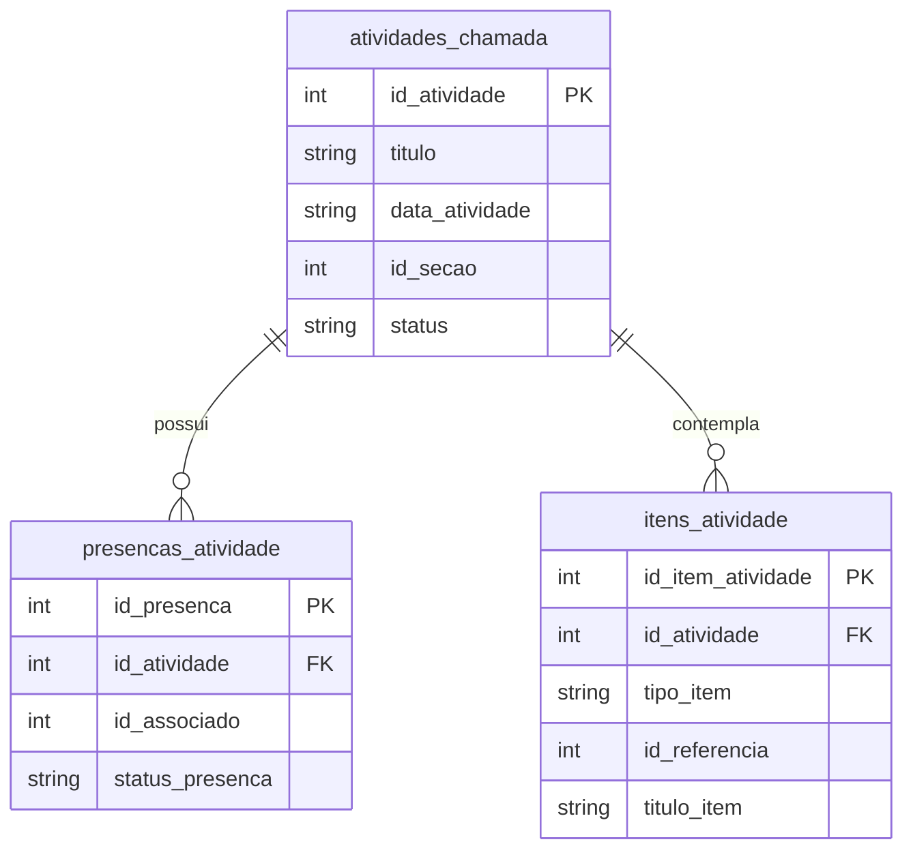

# Delta de Dados — Validação em Lote por Atividade

> Identificador: `001-validacao-lote-atividade`  
> Data: `2026-10-28`  
> Escala de Confiança: 🟢 CONFIRMADO (estruturado no schema SQLite local)

---

## 1. Novas Tabelas Locais (SQLite / `sqflite`)

### Tabela: `atividades_chamada`
Armazena as sessões de atividade criadas pelos escotistas.

```sql
CREATE TABLE atividades_chamada (
    id_atividade INTEGER PRIMARY KEY AUTOINCREMENT,
    titulo TEXT NOT NULL,
    descricao TEXT,
    data_atividade TEXT NOT NULL, -- ISO 8601 YYYY-MM-DD
    id_secao INTEGER NOT NULL,
    ramo TEXT NOT NULL, -- Lobinho, Escoteiro, Senior, Pioneiro
    status TEXT NOT NULL DEFAULT 'planejada', -- planejada, concluida, sincronizada
    criado_em TEXT NOT NULL,
    concluido_em TEXT
);
```

### Tabela: `presencas_atividade`
Registra a chamada nominal de cada associado na atividade.

```sql
CREATE TABLE presencas_atividade (
    id_presenca INTEGER PRIMARY KEY AUTOINCREMENT,
    id_atividade INTEGER NOT NULL,
    id_associado INTEGER NOT NULL,
    nome_associado TEXT NOT NULL,
    status_presenca TEXT NOT NULL DEFAULT 'presente', -- presente, ausente, justificado
    FOREIGN KEY (id_atividade) REFERENCES atividades_chamada(id_atividade) ON DELETE CASCADE
);
```

### Tabela: `itens_atividade`
Relaciona os itens pedagógicos trabalhados na atividade.

```sql
CREATE TABLE itens_atividade (
    id_item_atividade INTEGER PRIMARY KEY AUTOINCREMENT,
    id_atividade INTEGER NOT NULL,
    tipo_item TEXT NOT NULL, -- 'progressao' | 'especialidade'
    id_referencia INTEGER NOT NULL, -- idItem ou idEspecialidade
    titulo_item TEXT NOT NULL,
    descricao_requisito TEXT,
    FOREIGN KEY (id_atividade) REFERENCES atividades_chamada(id_atividade) ON DELETE CASCADE
);
```

---

## 2. Diagrama de Relacionamento Local


