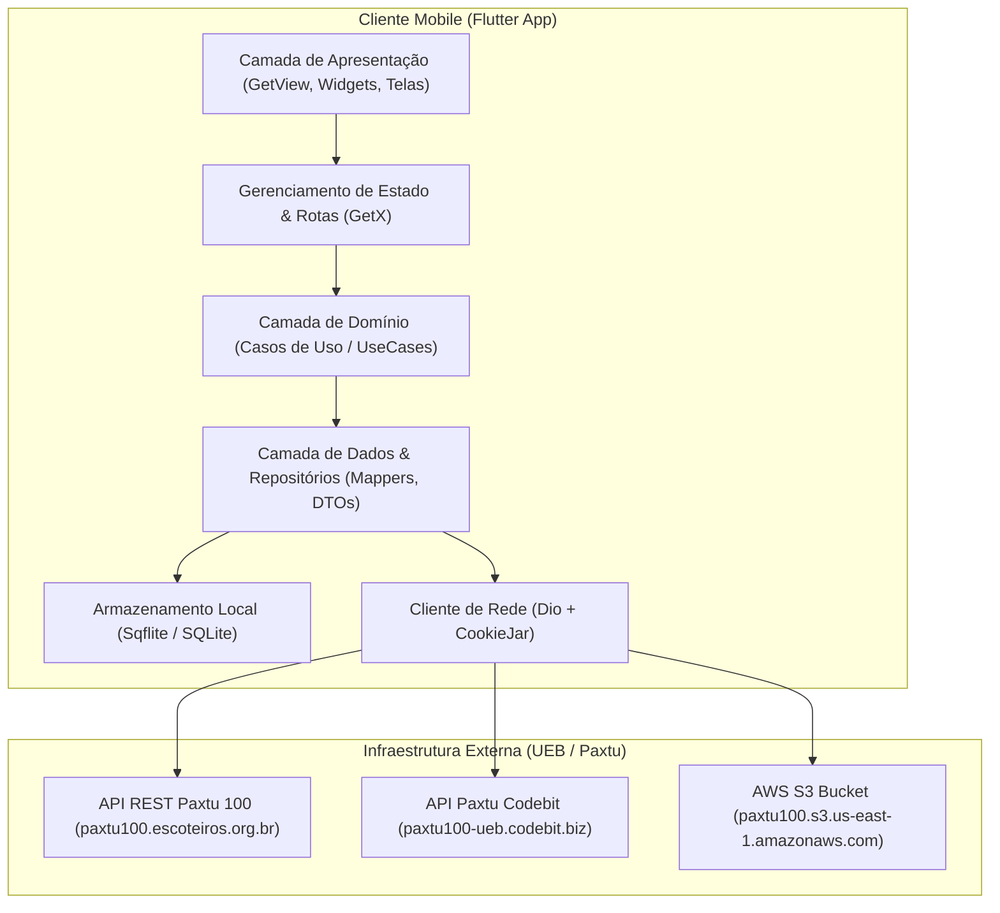
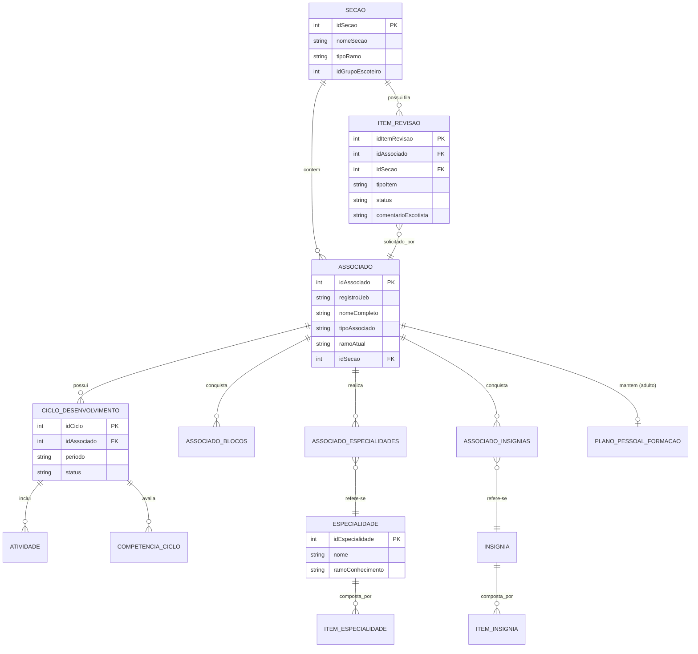

# Arquitetura do Sistema — mAPPa (Escoteiros do Brasil)

> **Gerado pelo Arquiteto (Reversa)**  
> **Data:** 2026-10-28  
> **Nível de Documentação:** Essencial  
> **Escala de Confiança:** 🟢 CONFIRMADO (extraído diretamente do binário compilado AOT `libapp.so` e assets)

---

## 1. Visão Geral da Arquitetura

O **mAPPa** é construído como um cliente móvel desacoplado, utilizando **Flutter (Dart AOT)** e operando em comunicação cliente-servidor com o backend institucional **Paxtu 100** dos Escoteiros do Brasil.

---

## 2. Diagrama Entidade-Relacionamento (ERD)

Representação das principais entidades lógicas do mAPPa e seus relacionamentos:

---

## 3. Catálogo de Integrações Externas

| Sistema Alvo | URL Base | Protocolo / Formato | Finalidade |
|--------------|----------|---------------------|------------|
| **Paxtu 100 Produção** | `https://paxtu100.escoteiros.org.br` | HTTPS / JSON REST | Autenticação (`/api/login`), perfil do associado, dados de seções e envio de aprovações. |
| **Paxtu 100 Codebit** | `https://paxtu100-ueb.codebit.biz` | HTTPS / JSON REST | Endpoints renovados de blocos, ciclos de competência e atividades variáveis. |
| **AWS S3 Storage** | `https://paxtu100.s3.us-east-1.amazonaws.com` | HTTPS / Imagens | Distribuição de imagens dos distintivos de especialidades e insígnias. |

---

## 4. Dívidas Técnicas e Observações Arquiteturais

1. **Coexistência de Legado e Código Novo:**  
   O binário contém tanto estruturas antigas da v1 (`package:maapa/mAPPa/`) quanto novas da v2 (`package:maapa/newmAPPa/`). Telas de revisão (`OldRevisaoView` e `NewRevisaoView` / `revisao_item_widget_mappa1.dart`) convivem no mesmo app, indicando migração gradual.
2. **Token Estático em `env.json`:**  
   O arquivo `env.json` no APK contém um token embutido (`00SSIsFJO...`), que atua como chave de API de aplicativo para acesso ao gateway do Paxtu antes do login do usuário individual.
3. **Sincronização Offline-First Híbrida:**  
   Embora o app utilize `sqflite` para cache local, o fluxo principal de submissão depende fortemente de conectividade síncrona com os endpoints do Paxtu para persistência oficial.
