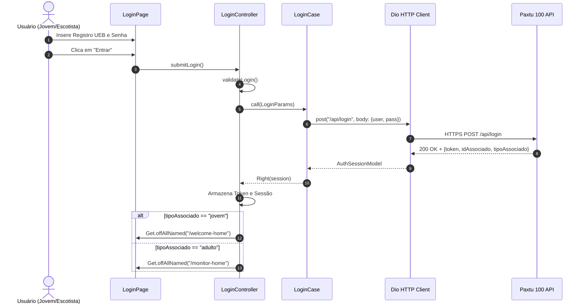

# Autenticação e Sessão (auth) — Design Técnico

> **Gerado pelo Redator (Reversa)**  
> **Data:** 2026-10-28  
> **Escala de Confiança:** 🟢 CONFIRMADO (extraído dos contratos Dio e use cases Dart)

---

## Interface e Contratos de Rede

### Endpoint de Autenticação

| Método | Caminho | Entrada (JSON Body) | Saída (JSON Response) | Status Codes |
|--------|---------|---------------------|-----------------------|--------------|
| `POST` | `/api/login` | `{"user": "string", "pass": "string"}` | `{"token": "string", "idAssociado": int, "tipoAssociado": "string"}` | 200, 401, 500 |

### Classes e Interfaces Dart

| Símbolo | Assinatura | Retorno | Observação |
|---------|-----------|---------|------------|
| `LoginCase.call` | `(LoginParams params)` | `Future<Either<Failure, AuthSession>>` | Executa chamada POST via Dio |
| `LoginController.validateLogin` | `(String user, String pass)` | `bool` | Valida campos não nulos / formato |
| `LoginController.submitLogin` | `()` | `Future<void>` | Orquestra loading, chamada e navegação |

---

## Fluxo Principal de Autenticação



---

## Fluxos Alternativos e Exceções

- **Credenciais Inválidas (401 Unauthorized):**
  - O Paxtu retorna erro 401.
  - `LoginCase` captura e retorna `Left(InvalidCredentialsFailure)`.
  - `LoginController` exibe SnackBar/Dialog com a mensagem: "Registro ou senha incorretos".
- **Sem Conexão com a Internet:**
  - `DioExceptionType.connectionTimeout` ou `connectionError`.
  - O app notifica: "Verifique sua conexão com a internet".

---

## Dependências
- **`dio` + `cookie_jar`:** Cliente de rede e interceptor de autenticação.
- **`get`:** Injeção de dependência via `LoginBinding` e roteamento de telas.
- **`dartz`:** Tipagem funcional `Either<Failure, Success>`.

---

## Observabilidade e Segurança
- Tokens de autenticação nunca são registrados em logs de console (`print` / `debugPrint`).
- Cabeçalho de autorização injetado automaticamente nas requisições subsequentes:
  ```http
  Authorization: Bearer <token>
  X-App-Token: 00SSIsFJO-jBRmgb2O4MIGlLLLwqPuFIfK_q14iYzj9ZmyyflxlMWMiPWqnjyLDNMrt--Y0JvnwMiD52e66dLg
  ```
