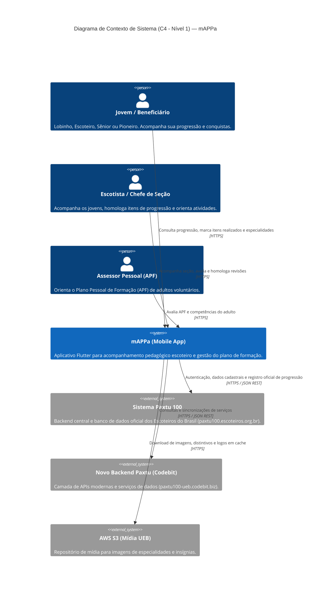

# Diagrama C4 — Nível 1: Contexto do Sistema

> **Gerado pelo Arquiteto (Reversa)**  
> **Data:** 2026-10-28  
> **Escala de Confiança:** 🟢 CONFIRMADO (integrações extraídas diretamente de `env.json` e `libapp.so`)

---

## 1. Visão Geral de Contexto

O diagrama abaixo ilustra o aplicativo **mAPPa** no centro do ecossistema escoteiro, seus usuários (Jovens, Escotistas, Assessores e Dirigentes) e as integrações com os sistemas da **União dos Escoteiros do Brasil (UEB)** e serviços em nuvem:

---

## 2. Descrição das Fronteiras e Protocolos

- **Clientes Mobile (iOS/Android):** Aplicativo compilado em Flutter com armazenamento SQLite local offline-first.
- **Protocolo de Comunicação:** Todas as comunicações utilizam HTTPS seguro com headers de autorização e cookies de sessão gerenciados via `CookieJar`.
- **Servidores Oficiais:**
  - `https://paxtu100.escoteiros.org.br`: Provedor de identidade e repositório mestre de dados de associados.
  - `https://paxtu100-ueb.codebit.biz`: Provedor de serviços e endpoints auxiliares.
  - `https://paxtu100.s3.us-east-1.amazonaws.com`: CDN de mídia estática.
