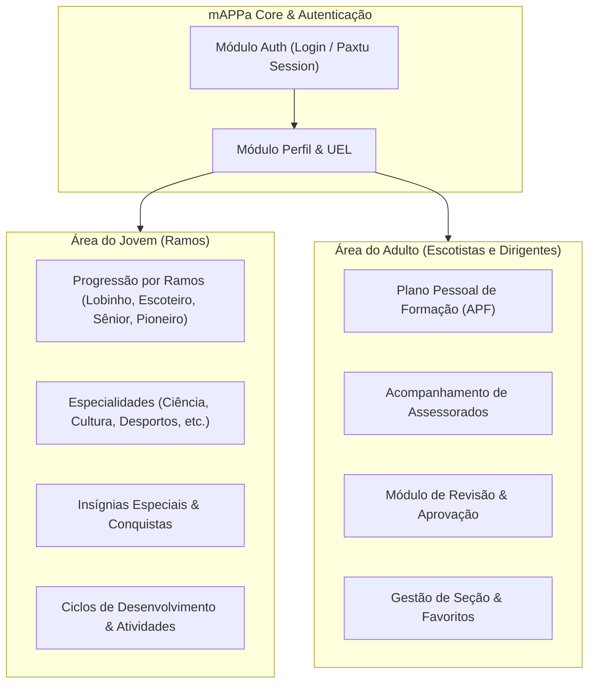

# Inventário do Sistema — mAPPa (Escoteiros do Brasil)

> **Gerado pelo Scout (Reversa)**  
> **Data:** 2026-10-28  
> **Artefato:** `mAPPa_1.0.5_APKPure.xapk`  
> **Escala de Confiança:** 🟢 CONFIRMADO (extraído diretamente do binário/assets compilados)

---

## 1. Visão Geral

O **mAPPa** é o aplicativo oficial dos **Escoteiros do Brasil** (União dos Escoteiros do Brasil - UEB), destinado ao acompanhamento da progressão pessoal de jovens (Lobinhos, Escoteiros, Seniores e Pioneiros) e à gestão do Plano Pessoal de Formação (APF) de adultos voluntários (Escotistas e Dirigentes).

| Propriedade | Valor |
|-------------|-------|
| **Nome do App** | mAPPa |
| **Package Name** | `br.org.escoteiros.mappa` |
| **Versão** | `1.0.5` (Build `71`) |
| **Formato de Distribuição** | XAPK (Split APKs: Base, ARM64-v8a, Localização EN/FR, Densidade XXXHDPI) |
| **Tecnologia Principal** | **Flutter** (Dart AOT / Android NDK) |
| **Gerenciador de Estado / Rotas** | **GetX** |
| **Cliente HTTP / APIs** | **Dio** + **CookieJar** |
| **Persistência Local** | **Sqflite** (SQLite) |
| **Backend de Integração** | **Paxtu 100** (REST API) |
| **Target SDK / Min SDK** | Android Min SDK 24 (Android 7.0) / Target SDK 36 |

---

## 2. Estrutura do Pacote (.xapk)

O arquivo `mAPPa_1.0.5_APKPure.xapk` é composto por 5 APKs split e metadados:

- `br.org.escoteiros.mappa.apk` (8.35 MB): APK base contendo o bytecode Android (`classes.dex`), recursos visuais, ícones, fontes (`MaterialIcons`, `FontAwesome`, `CupertinoIcons`) e o bundle `flutter_assets`.
- `config.arm64_v8a.apk` (21.43 MB): Binários compilados para arquitetura ARM 64-bit, contendo a engine Flutter (`libflutter.so`) e a lógica de negócio em Dart compilado AOT (`libapp.so`).
- `config.en.apk` (33 KB): Recursos de internacionalização para língua inglesa.
- `config.fr.apk` (20 KB): Recursos de internacionalização para língua francesa.
- `config.xxxhdpi.apk` (53 KB): Recursos gráficos otimizados para telas de alta densidade.
- `manifest.json`: Metadados do pacote XAPK e declaração das dependências split.

---

## 3. Configurações de Conexão e Backends

Extraído diretamente de `assets/flutter_assets/assets/env.json`:

```json
{
    "BASEURL": "https://paxtu100.escoteiros.org.br",
    "TOKEN": "00SSIsFJO-jBRmgb2O4MIGlLLLwqPuFIfK_q14iYzj9ZmyyflxlMWMiPWqnjyLDNMrt--Y0JvnwMiD52e66dLg",
    "NEWBASEURL": "https://paxtu100-ueb.codebit.biz"
}
```

- **Servidor de Produção Paxtu:** `https://paxtu100.escoteiros.org.br`
- **Ambiente de Serviços / API Renovada:** `https://paxtu100-ueb.codebit.biz`
- **Repositório de Mídia / S3:** `https://paxtu100.s3.us-east-1.amazonaws.com/new-progression/specialties/`

---

## 4. Mapeamento Completo de Endpoints REST (/api)

Identificados 58 endpoints no binário `libapp.so`, agrupados por domínio:

### 4.1. Autenticação e Perfil
- `POST /api/login`: Autenticação de associados (Jovens e Adultos)
- `GET /api/perfil`: Consulta aos dados cadastrais do associado
- `POST /api/perfil-foto`: Atualização da foto de perfil
- `GET /api/associado-home`: Dados consolidados para a tela inicial

### 4.2. Gestão de Jovens e Ramos (Progressão Jovem)
- `GET /api/progressoes-associado-id`: Detalhamento da progressão por ID
- `GET /api/blocos`: Blocos de progressão escoteira
- `GET /api/blocos/associado`: Blocos em andamento do jovem
- `GET /api/ciclos`: Ciclos de desenvolvimento
- `POST /api/criar-ciclo`: Criação de novo ciclo de progressão
- `GET /api/competencias`: Competências avaliadas
- `GET /api/competencias-ciclo`: Competências associadas ao ciclo ativo
- `GET /api/competencia-itens`: Lista de itens específicos da competência
- `POST /api/salvar-item`: Marcação de item de progressão conquistado
- `POST /api/salvar-itens-competencia`: Registro em lote de competências
- `GET /api/itens-avaliacao`: Itens pendentes de avaliação
- `GET /api/introdutorio`: Etapa de integração/período introdutório
- `POST /api/salvar-itens-introducao`: Registro da etapa introdutória

### 4.3. Especialidades Escoteiras
- `GET /api/especialidades`: Catálogo geral de especialidades (5 ramos de conhecimento)
- `GET /api/eixo/especialidades`: Especialidades agrupadas por eixo
- `GET /api/eixo/especialidades/itens`: Requisitos e itens de especialidades
- `GET /api/eixo/especialidades/itens/associado`: Status dos itens conquistados pelo jovem
- `GET /api/especialidades-itens-associado`: Conquistas de especialidades do associado
- `GET /api/especialidades-tipo-associado`: Tipos e níveis de especialidades
- `POST /api/salvar-especialidade`: Submissão de conquista de especialidade

### 4.4. Insígnias de Interesse Especial
- `GET /api/insignias`: Catálogo de insígnias de interesse especial (ex: Aprender, Lusofonia, BP, Cone Sul, Campeões da Natureza)
- `GET /api/insignias_especiais`: Lista detalhada de insígnias
- `GET /api/insignia/itens`: Itens necessários para conquista da insígnia
- `GET /api/insignias-especiais-associado`: Insígnias conquistadas pelo jovem
- `POST /api/salvar-insignia`: Submissão de conquista de insígnia especial

### 4.5. Plano Pessoal de Formação do Adulto (APF)
- `GET /api/assessorados`: Jovens ou adultos sob assessoria do escotista
- `GET /api/adulto-progressao/`: Progressão formativa do adulto
- `GET /api/adulto-progressao-atividade`: Atividades ligadas à formação do escotista
- `POST /api/salvar-linha-formacao`: Linha de formação (Escotista ou Dirigente)
- `POST /api/salvar-linha-ramo`: Ramo de atuação do adulto (Alcateia, Tropa, Clã)
- `POST /api/salvar-plano-pessoal`: Salvar APF
- `POST /api/salvar-item-adulto`: Registro de competência do adulto

### 4.6. Painel do Escotista / Monitor e Revisão
- `GET /api/equipe-monitor`: Membros da equipe de escotistas/monitores
- `GET /api/secoes`: Seções da Unidade Escoteira Local (UEL)
- `GET /api/secoes-favoritos`: Seções marcadas como favoritas
- `GET /api/favoritos-associado`: Lista de jovens favoritados pelo escotista
- `POST /api/favoritar-associado`: Alternar favorito de um jovem
- `GET /api/itens-revisao`: Itens de progressão submetidos que aguardam revisão do escotista
- `GET /api/itens-revisao-anterior`: Histórico de itens revisados
- `POST /api/marcar-item-revisao`: Aprovação ou devolução de item de progressão

### 4.7. Atividades e Comunicação
- `GET /api/acoes/`: Ações gerais
- `GET /api/acoes/associado`: Ações e participações do associado
- `POST /api/salvar-acoes`: Registro de ações realizadas
- `POST /api/adicionar-variavel`: Registro de atividade variável de ciclo
- `POST /api/conversar`: Envio de mensagem / feedback para o jovem
- `POST /api/conversar-adulto`: Envio de mensagem entre escotistas/assessores
- `GET /api/mensagem-associado`: Mensagens recebidas
- `GET /api/historico`: Histórico de interações e alterações

---

## 5. Módulos de Domínio Identificados



---

## 6. Permissões Android (AndroidManifest.xml)

- `android.permission.INTERNET`: Comunicação com APIs do Paxtu e storage AWS S3.
- `android.permission.CAMERA`: Captura de fotos para comprovação de atividades e perfil.
- `android.permission.RECORD_AUDIO`: Gravação de áudio em avaliações/relatos.
- `android.permission.WRITE_EXTERNAL_STORAGE` / `READ_EXTERNAL_STORAGE`: Salvamento e upload de relatórios, fichas e fotos.
- `android.permission.READ_MEDIA_AUDIO`: Leitura de arquivos de áudio locais.
