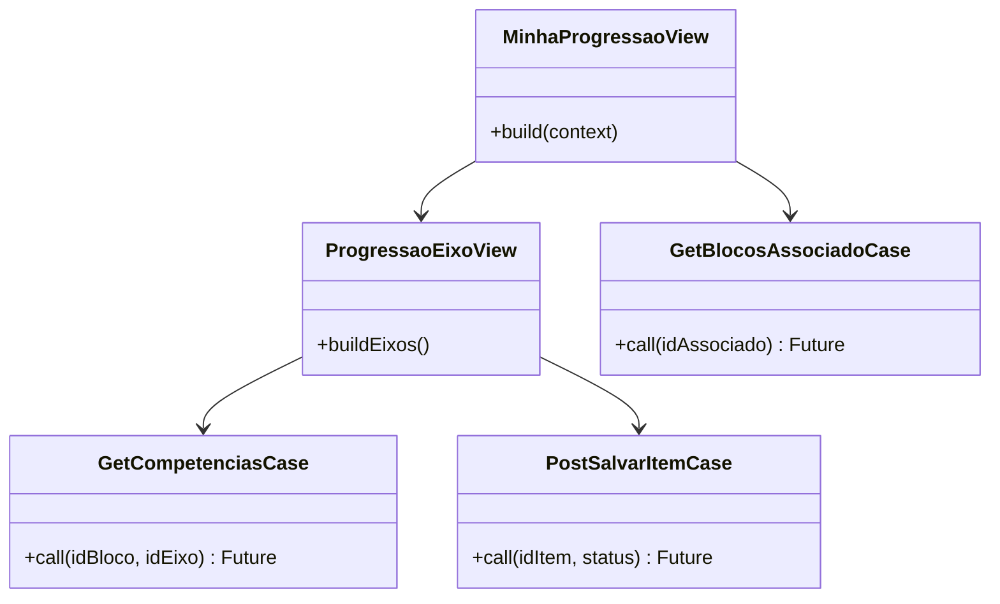

# Progressão do Jovem (jovem-progressao) — Design Técnico

> **Gerado pelo Redator (Reversa)**  
> **Data:** 2026-10-28  
> **Escala de Confiança:** 🟢 CONFIRMADO (extraído dos use cases em Dart)

---

## Contratos de API REST

| Método | Caminho | Entrada | Saída | Status Codes |
|--------|---------|---------|-------|--------------|
| `GET` | `/api/blocos` | Headers de Sessão | Lista de blocos do ramo (`List<BlocoProgressaoModel>`) | 200, 401 |
| `GET` | `/api/blocos/associado` | `idAssociado: int` | Status de conclusão dos blocos do associado | 200, 401 |
| `GET` | `/api/ciclos` | `idAssociado: int` | Ciclos semestrais de desenvolvimento | 200, 401 |
| `POST` | `/api/criar-ciclo` | `{"idAssociado": int, "periodo": string}` | `{"idCiclo": int, "sucesso": true}` | 201, 400 |
| `GET` | `/api/competencias` | `idBloco: int, idEixo: int` | Lista de competências e itens descritivos | 200, 401 |
| `POST` | `/api/salvar-item` | `{"idItem": int, "idAssociado": int, "concluido": bool}` | Confirmação de submissão do item | 200, 400 |

---

## Estrutura de Use Cases e Telas

---

## Gestão de Estado Local e Offline
- As listas de competências e itens são cacheadas em banco local SQLite (`sqflite`).
- Itens marcados sem internet são mantidos com flag `syncPending: true` e sincronizados automaticamente na reconexão.
