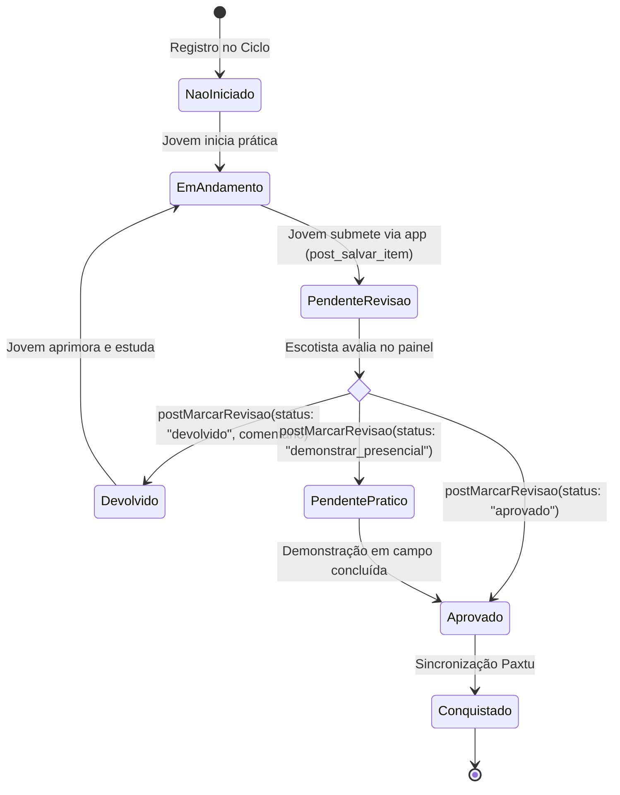
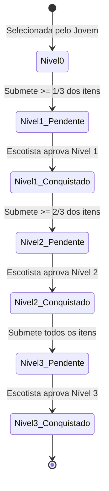
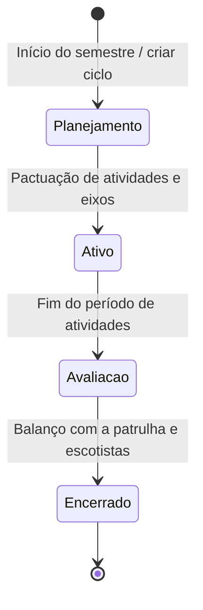

# Máquinas de Estado — mAPPa

> **Gerado pelo Detetive (Reversa)**  
> **Data:** 2026-10-28  
> **Escala de Confiança:** 🟢 CONFIRMADO (extraído do fluxo de use cases e widgets de revisão)

---

## 1. Ciclo de Vida do Item de Progressão / Competência

O item de progressão passa por estados que refletem o diálogo educativo entre o jovem e o escotista:

### Transições e Gatilhos:
- **`NaoIniciado` $\to$ `EmAndamento`:** O jovem seleciona a competência no ciclo vigente.
- **`EmAndamento` $\to$ `PendenteRevisao`:** O jovem marca o item como realizado no app (`MinhaProgressaoItensView`).
- **`PendenteRevisao` $\to$ `Aprovado`:** O escotista clica em aprovar no widget de revisão (`RevisaoItemWidget`). O item é computado para a conquista do bloco/distintivo.
- **`PendenteRevisao` $\to$ `Devolvido`:** O escotista envia mensagem explicando o que falta para completar a atividade.

---

## 2. Ciclo de Vida da Especialidade Escoteira

---

## 3. Ciclo de Desenvolvimento Semestral (Jovem)

